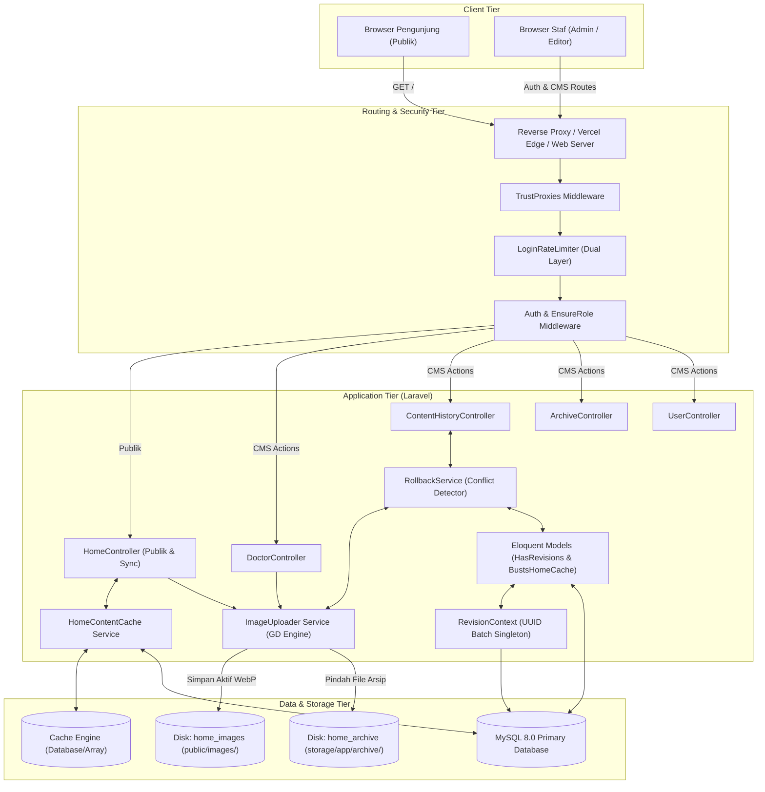
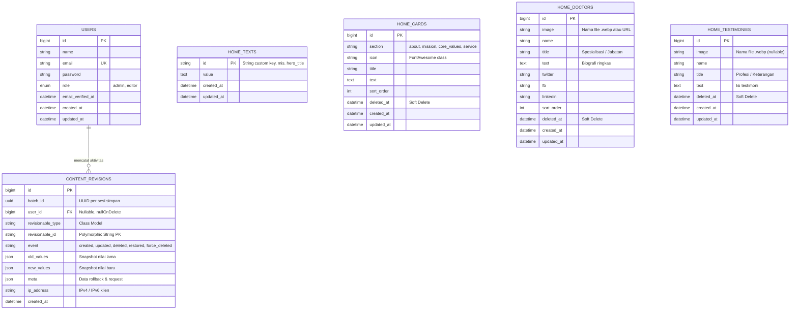
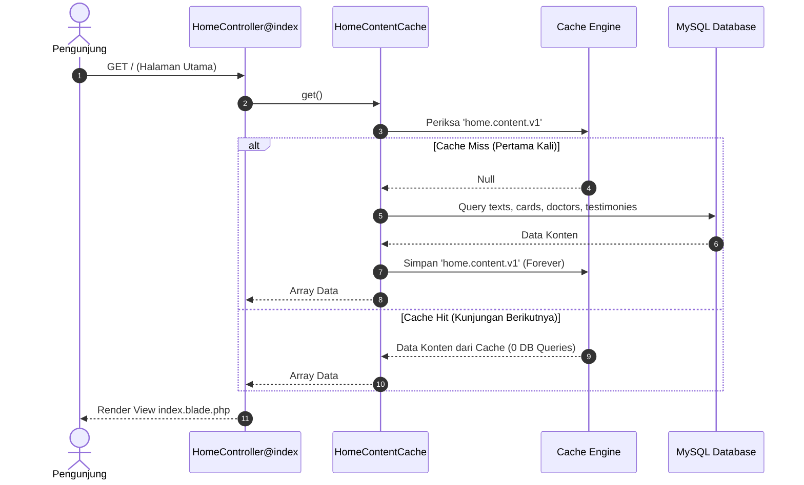
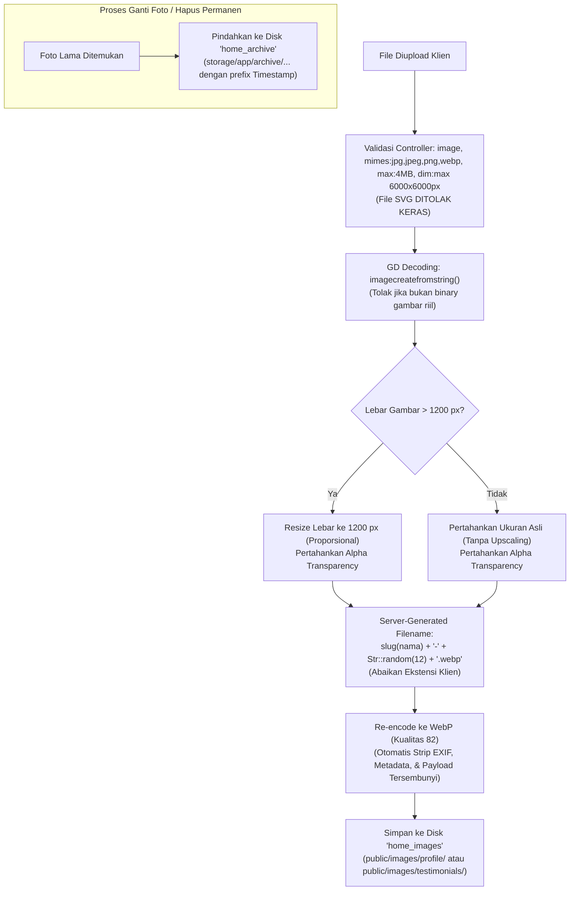

# DOKUMENTASI SISTEM DAN ARSITEKTUR PERANGKAT LUNAK
# WEBSITE PROFIL & CONTENT MANAGEMENT SYSTEM (CMS)
# PRESIDENT UNIVERSITY HOSPITAL (PUH)

---

## DAFTAR ISI
1. [BAB 1: Pendahuluan & Gambaran Umum Sistem](#bab-1-pendahuluan--gambaran-umum-sistem)
   - 1.1 Latar Belakang & Profil Institusi
   - 1.2 Deskripsi Sistem
   - 1.3 Ruang Lingkup & Peran Pengguna (Actors)
2. [BAB 2: Arsitektur Sistem & Spesifikasi Teknologi](#bab-2-arsitektur-sistem--spesifikasi-teknologi)
   - 2.1 Technology Stack
   - 2.2 Diagram Arsitektur Aplikasi
   - 2.3 Lingkungan Eksekusi & Kontainerisasi (Docker)
3. [BAB 3: Perancangan Basis Data (Database Schema & Dictionary)](#bab-3-perancangan-basis-data-database-schema--dictionary)
   - 3.1 Entity-Relationship Diagram (ERD)
   - 3.2 Kamus Data & Spesifikasi Tabel
4. [BAB 4: Modul, Fitur & Implementasi Teknis](#bab-4-modul-fitur--implementasi-teknis)
   - 4.1 Modul Halaman Publik & Caching Performa Tinggi
   - 4.2 Modul Autentikasi & Keamanan (Rate Limiting & Proxy Trusting)
   - 4.3 Modul Kontrol Akses Berbasis Peran (Role-Based Access Control / RBAC)
   - 4.4 Modul Pemrosesan & Pengerasan Upload Gambar (Image Uploader Service)
   - 4.5 Modul Manajemen Konten (CMS Dashboard & Beranda)
   - 4.6 Modul Audit Trail, Riwayat Revisi & Rollback Otomatis
   - 4.7 Modul Pengarsipan & Pemulihan Data (Soft Delete & Restore)
5. [BAB 5: Struktur Direktori & Pola Desain (Design Patterns)](#bab-5-struktur-direktori--pola-desain-design-patterns)
   - 5.1 Struktur Direktori Proyek
   - 5.2 Pola Desain yang Diterapkan
6. [BAB 6: Pengujian Sistem & Jaminan Kualitas (QA)](#bab-6-pengujian-sistem--jaminan-kualitas-qa)
   - 6.1 Strategi Pengujian
   - 6.2 Matriks Cakupan Test Case (47 Tests)
   - 6.3 Standardisasi Gaya Kode (Code Styling)
7. [BAB 7: Panduan Instalasi, Konfigurasi & Pengoperasian](#bab-7-panduan-instalasi-konfigurasi--pengoperasian)
   - 7.1 Prasyarat Sistem
   - 7.2 Konfigurasi Environment (`.env`)
   - 7.3 Menjalankan Sistem Menggunakan Docker
   - 7.4 Command Artisan Khusus

---

## BAB 1: Pendahuluan & Gambaran Umum Sistem

### 1.1 Latar Belakang & Profil Institusi
President University Hospital (PUH) merupakan rumah sakit umum modern yang terintegrasi langsung dengan President University dalam kerangka *Academic Health System* (AHS). PUH berfungsi sebagai penyedia layanan kesehatan profesional sekaligus pusat pendidikan medis, riset kedokteran, dan inovasi klinis. 

Untuk merepresentasikan reputasi institusi medis berskala internasional dan mendukung pelayanan kepada masyarakat industri maupun umum, dibangunlah aplikasi web profil interaktif yang dilengkapi dengan Content Management System (CMS) mandiri.

### 1.2 Deskripsi Sistem
Aplikasi Web President University Hospital adalah platform berbasis web monolitik modern yang menggabungkan:
1. **Portal Publik (Frontend Landing Page):** Menyajikan profil rumah sakit, visi, misi, nilai inti (*core values*), daftar layanan medis, jajaran pimpinan/dewan direksi (*Board of Directors/Leaders*), testimoni pasien, artikel edukasi, serta kontak darurat dan lokasi.
2. **Panel Administrasi (Backend CMS):** Memfasilitasi pengelolaan seluruh konten halaman depan, manajemen akun pengguna, pelacakan riwayat revisi (audit trail), pemulihan data (rollback), serta pengarsipan data secara aman dan terstruktur.

Aplikasi dirancang dengan standar keamanan enterprise, efisiensi caching database, pemrosesan aset gambar otomatis, serta pertahanan berlapis terhadap serangan siber umum seperti *Brute-Force*, *Cross-Site Scripting (XSS)*, *Privilege Escalation*, dan *Malicious File Upload*.

### 1.3 Ruang Lingkup & Peran Pengguna (Actors)
Aplikasi membedakan hak akses pengguna menjadi tiga tingkatan:

| Peran (Role) | Ruang Lingkup Akses & Wewenang |
|---|---|
| **Publik (Guest / Pasien)** | - Mengakses halaman beranda profil rumah sakit.<br>- Melihat informasi dokter, layanan, visi-misi, testimoni, dan kontak.<br>- Melakukan pencarian dan membaca modal profil pimpinan medis.<br>- Tidak memiliki akses ke panel administrasi. |
| **Editor** | - Mengakses panel CMS (`/admin`).<br>- Mengubah teks informasi umum, layanan, dan media sosial.<br>- Menambah, memperbarui, mengurutkan (*sort order*), dan menghapus sementara (*soft delete*) data dokter/testimoni.<br>- Melihat halaman Arsip dan memulihkan data (*restore*) yang terhapus.<br>- **Dilarang:** Mengakses manajemen akun pengguna (`/admin/users`), membuka menu Riwayat & Rollback (`/admin/history`), atau melakukan hapus permanen (*force delete*). |
| **Administrator** | - Memiliki seluruh wewenang peran Editor.<br>- Mengelola akun staf pengguna (CRUD Users) dan menentukan perannya.<br>- Mengakses menu Audit Riwayat Konten (`/admin/history`) per sesi simpan (*batch*).<br>- Melihat perbandingan diff revisi data (*old vs new values*).<br>- Mengeksekusi fitur Rollback revisi data.<br>- Melakukan penghapusan permanen (*force delete*) data pada tab Arsip.<br>- Terproteksi oleh *Safety Guard* (tidak dapat menghapus diri sendiri dan tidak dapat menghapus/menurunkan peran admin terakhir di sistem). |

---

## BAB 2: Arsitektur Sistem & Spesifikasi Teknologi

### 2.1 Technology Stack
Aplikasi dibangun di atas pondasi teknologi modern:

* **Backend Framework:** Laravel 13.x (PHP 8.3+)
* **Database Management System:** 
  * MySQL 8.0 (Environment Pengembangan Docker & Produksi)
  * SQLite In-Memory (Environment Automated Testing / PHPUnit)
* **Frontend UI Engine:**
  * Blade Templating Engine
  * Tailwind CSS v4 (Desain antarmuka responsif dan modern)
  * Alpine.js (Komponen interaktif ringan, modal popup, hamburger menu)
  * FontAwesome 6 (Ikonografi medis dan sistem)
* **Image Processing Engine:** PHP GD Extension (WebP re-encoding, resizing, EXIF stripping)
* **Containerization:** Docker & Docker Compose (Laravel Sail compatible)
* **Deployment Readiness:** Serverless Vercel ready & traditional Linux VM ready.

### 2.2 Diagram Arsitektur Aplikasi



### 2.3 Lingkungan Eksekusi & Kontainerisasi (Docker)
Aplikasi dikemas dalam arsitektur kontainer `docker-compose.yml`:
* **Kontainer 1 (`laravel.test`):** Berbasis Ubuntu/PHP 8.4 dengan ekstensi lengkap (GD, SQLite, MySQL PDO, Zip, Curl, OPcache).
* **Kontainer 2 (`mysql`):** Layanan basis data MySQL 8.0 dengan volume persisten `sail-mysql` dan network bridge internal `sail`.
* **Binding Port:** Port 80 diarahkan ke web server lokal, Port 3306 diarahkan ke MySQL lokal.

---

## BAB 3: Perancangan Basis Data (Database Schema & Dictionary)

### 3.1 Entity-Relationship Diagram (ERD)



### 3.2 Kamus Data & Spesifikasi Tabel

#### 1. Tabel `users`
Menyimpan identitas pengguna yang memiliki hak login ke panel administrasi.
* `id` (BIGINT, Primary Key, Auto Increment)
* `name` (VARCHAR 255): Nama lengkap pengguna.
* `email` (VARCHAR 255, Unique Index): Alamat email resmi pengguna.
* `password` (VARCHAR 255): Password yang telah dienkripsi menggunakan algoritma Bcrypt / Argon2.
* `role` (ENUM('admin', 'editor'), Default: 'editor'): Tingkat wewenang hak akses pengguna di CMS.
* `created_at`, `updated_at` (TIMESTAMP).

#### 2. Tabel `home_texts`
Tabel dinamis dengan pola *Key-Value Store* untuk seluruh blok teks pada halaman profil.
* `id` (VARCHAR 255, Primary Key, Non-Incrementing): Pengenal unik string teks, contoh: `hero_badge`, `hero_title`, `hero_desc`, `about_title`, `academic_desc`, `phone`, `email`.
* `value` (TEXT): Nilai atau konten teks yang ditampilkan.
* `created_at`, `updated_at` (TIMESTAMP).

#### 3. Tabel `home_cards`
Menyimpan komponen kartu informasi berulang pada bagian Tentang Kami, Visi-Misi, Nilai Inti, dan Fasilitas Layanan.
* `id` (BIGINT, Primary Key, Auto Increment)
* `section` (VARCHAR 255, Index): Kategori penempatan kartu (`about`, `mission`, `core_values`, `service`).
* `icon` (VARCHAR 255, Nullable): Kelas ikon FontAwesome (misal: `fas fa-heartbeat`).
* `title` (VARCHAR 255): Judul kartu layanan.
* `text` (TEXT, Nullable): Uraian penjelasan kartu.
* `sort_order` (INTEGER, Default: 0): Nomor urutan tampilan kartu.
* `deleted_at` (TIMESTAMP, Nullable, Index): Timestamp soft delete untuk pengarsipan.
* `created_at`, `updated_at` (TIMESTAMP).

#### 4. Tabel `home_doctors`
Menyimpan data jajaran direksi, dokter spesialis, dan pimpinan rumah sakit.
* `id` (BIGINT, Primary Key, Auto Increment)
* `image` (VARCHAR 255): Nama file foto (format `.webp`) yang tersimpan di disk atau URL eksternal.
* `name` (VARCHAR 255): Nama lengkap beserta gelar.
* `title` (VARCHAR 255): Jabatan struktural atau spesialisasi medis.
* `text` (TEXT): Profil biografi singkat atau latar belakang profesional.
* `twitter`, `fb`, `linkedin` (VARCHAR 255, Nullable): Link profil jejaring sosial profesional.
* `sort_order` (INTEGER, Default: 0): Urutan tampilan dokter di halaman utama.
* `deleted_at` (TIMESTAMP, Nullable, Index): Timestamp soft delete.
* `created_at`, `updated_at` (TIMESTAMP).

#### 5. Tabel `home_testimonies`
Menyimpan ulasan dan testimoni dari pasien atau mitra institusi.
* `id` (BIGINT, Primary Key, Auto Increment)
* `image` (VARCHAR 255, Nullable): Foto pemberi testimoni.
* `name` (VARCHAR 255): Nama lengkap pasien/klien.
* `title` (VARCHAR 255): Status atau profesi pemberi ulasan.
* `text` (TEXT): Uraian testimoni pengalaman layanan kesehatan.
* `deleted_at` (TIMESTAMP, Nullable, Index): Timestamp soft delete.
* `created_at`, `updated_at` (TIMESTAMP).

#### 6. Tabel `content_revisions`
Pusat pencatatan audit log, tracking versioning, dan engine rollback.
* `id` (BIGINT, Primary Key, Auto Increment)
* `batch_id` (CHAR 36 / UUID, Index): Pengenal unik batch sesi simpan. Satu kali klik tombol simpan = satu batch ID untuk semua model yang terdampak.
* `user_id` (BIGINT, Nullable, Foreign Key ke `users.id` ON DELETE SET NULL): Pengguna yang melakukan perubahan.
* `revisionable_type` (VARCHAR 255): Nama kelas model (`App\Models\HomeDoctor`, `App\Models\HomeText`, dll).
* `revisionable_id` (VARCHAR 255): Kunci primer record yang berubah (bertipe string untuk mendukung PK string milik `HomeText`).
* `event` (VARCHAR 50): Jenis kejadian (`created`, `updated`, `deleted`, `restored`, `force_deleted`).
* `old_values` (JSON, Nullable): Snapshot data sebelum diubah atau sebelum dihapus.
* `new_values` (JSON, Nullable): Snapshot data setelah diubah atau saat dibuat baru.
* `meta` (JSON, Nullable): Metadata operasional (misalnya `rolled_back_batch` jika revisi merupakan hasil proses rollback).
* `ip_address` (VARCHAR 45, Nullable): Alamat IP klien (IPv4 / IPv6).
* `created_at` (TIMESTAMP, Index): Waktu pasti revisi terjadi (tanpa kolom `updated_at`).
* **Composite Index:** `(revisionable_type, revisionable_id)` untuk pencarian riwayat spesifik record secara instan.

---

## BAB 4: Modul, Fitur & Implementasi Teknis

### 4.1 Modul Halaman Publik & Caching Performa Tinggi

#### Konsep & Mekanisme
Halaman depan publik (`/`) merupakan halaman yang paling sering diakses pengunjung. Jika setiap request pengunjung mengeksekusi puluhan query database (`HomeText`, `HomeCard`, `HomeDoctor`, `HomeTestimony`), database akan mengalami beban tinggi (*high database load*). 

Sistem menerapkan arsitektur **Persistent In-Memory / File Caching**:
1. **Service `App\Support\HomeContentCache`:**
   Memanggil `Cache::rememberForever('home.content.v1', ...)` untuk mengagregasi seluruh komponen data beranda ke dalam satu payload array.
   * Pada request pertama (*cache miss*): Data ditarik dari database, disimpan ke cache, lalu dikirim ke view.
   * Pada request kedua dan seterusnya (*cache hit*): Data langsung dibaca dari memory/cache tanpa mengeksekusi satu pun query ke database (`0 content queries`).
2. **Auto-Bust Trait (`App\Models\Concerns\BustsHomeCache`):**
   Trait ini disematkan pada seluruh model konten (`HomeCard`, `HomeDoctor`, `HomeTestimony`, `HomeText`). Memanfaatkan Eloquent model lifecycle events:
   * `saved` (saat create atau update)
   * `deleted` (saat soft delete)
   * `restored` (saat data dipulihkan)
   * `forceDeleted` (saat data dihapus permanen)
   
   Ketika salah satu kejadian di atas terpicu di panel admin, trait secara instan mengeksekusi `HomeContentCache::flush()`, menghapus cache beranda sehingga pengunjung publik langsung melihat perubahan terbaru pada kunjungan berikutnya.



---

### 4.2 Modul Autentikasi & Keamanan (Rate Limiting & Proxy Trusting)

#### Pertahanan Login & Brute-Force Throttling
Modul autentikasi diimplementasikan di [app/Http/Controllers/LoginController.php](file:///d:/Coding/Web/president-purth-app/app/Http/Controllers/LoginController.php) dengan mekanisme pertahanan berlapis:
1. **Dual-Layer Rate Limiting via `RateLimiter` Facade:**
   * **Batas Primer (Akun & IP):** Maksimal 5 kali kegagalan per menit berdasarkan kombinasi lowercase email dan IP klien (`Str::lower($request->input('email')) . '|' . $request->ip()`).
   * **Batas Sekunder (IP Global):** Maksimal 30 kali kegagalan per jam untuk satu IP klien (`login:ip:{$request->ip()}`) guna mencegah serangan *distributed credential stuffing*.
2. **Pemberitahuan Countdown Dinamis:**
   Ketika batas terlampaui, request langsung diblokir tanpa memeriksa password ke database dan memunculkan notifikasi berbahasa Indonesia:
   > *"Terlalu banyak percobaan login. Coba lagi dalam N detik."* (dihitung otomatis melalui `RateLimiter::availableIn($throttleKey)`).
3. **Pembersihan Throttling:**
   Saat pengguna memasukkan email dan password yang valid, hitungan throttle langsung direset via `RateLimiter::clear($throttleKey)`.
4. **Proxy Trusting:**
   Pada deployment cloud/serverless (seperti Vercel atau reverse proxy Nginx), IP klien sering kali tersamarkan menjadi IP internal proxy. Melalui konfigurasi `$middleware->trustProxies(at: '*')` di [bootstrap/app.php](file:///d:/Coding/Web/president-purth-app/bootstrap/app.php), aplikasi menjamin pembacaan `$request->ip()` merupakan IP asli klien di internet.

---

### 4.3 Modul Kontrol Akses Berbasis Peran (Role-Based Access Control / RBAC)

#### Arsitektur RBAC
Hak akses dikelola secara deklaratif menggunakan enum PHP 8 backed string:
* **Enum `App\Enums\Role`:**
  * `Role::Admin = 'admin'` (Label: "Administrator")
  * `Role::Editor = 'editor'` (Label: "Editor")
* **Middleware `App\Http\Middleware\EnsureRole`:**
  Didaftarkan dengan alias `'role'` pada pipeline aplikasi. Mendukung multi-role variadik (`role:admin` atau `role:admin,editor`). Pengguna yang tidak memenuhi role akan langsung ditolak dengan kode status HTTP `403 Forbidden` dan disajikan tampilan error resmi berbahasa Indonesia di [resources/views/errors/403.blade.php](file:///d:/Coding/Web/president-purth-app/resources/views/errors/403.blade.php).
* **Proteksi Integritas Role & User Guard:**
  * Kolom `role` tidak dimasukkan ke dalam `$fillable` mass-assignment pada model `User` untuk mencegah eskalasi hak akses (*privilege escalation* via request injection).
  * **Self-Deletion Guard:** Pengguna dilarang menghapus akunnya sendiri yang sedang aktif digunakan login.
  * **Last-Admin Guard:** Sistem secara ketat memeriksa keberadaan akun administrator lain. Pengguna dilarang menghapus atau menurunkan role (*demote*) akun Administrator terakhir di sistem agar sistem tidak mengalami *lockout*.
* **Password Policy:**
  Dikonfigurasi melalui `Password::defaults()` pada `AppServiceProvider` dengan standar ketat: minimal 10 karakter, kombinasi huruf besar dan kecil (*mixed case*), serta mengandung angka.

---

### 4.4 Modul Pemrosesan & Pengerasan Upload Gambar (Image Uploader Service)

#### Arsitektur Keamanan Upload Terisolasi
Seluruh upload gambar dienkapsulasi ke dalam service tunggal [app/Services/ImageUploader.php](file:///d:/Coding/Web/president-purth-app/app/Services/ImageUploader.php). Sistem menerapkan proteksi mendalam (*defense-in-depth*):



#### Spesifikasi Fitur ImageUploader
1. **Pencegahan File Polyglot & Payload Injection:**
   Banyak malware menyamar sebagai file `.jpg` atau `.png` yang menyisipkan skrip PHP di dalam metadata EXIF atau komentar file. Dengan mendekode ulang binary gambar via `imagecreatefromstring()` dan merender ulang (*re-encoding*) ke format WebP murni, seluruh payload tersembunyi dan metadata EXIF otomatis lenyap (*stripped*).
2. **Penolakan SVG:** File vector SVG berisiko membawa serangan *Stored XSS* berbasis XML tag `<script>`. Sistem secara eksplisit menolak SVG pada layer validasi.
3. **Penyimpanan Dua Disk:**
   * Disk `home_images` (Root: `public_path('images')`): Tempat gambar aktif yang disajikan langsung ke web.
   * Disk `home_archive` (Root: `storage_path('app/archive')`): Area tertutup di luar jangkauan publik untuk menampung gambar lama saat foto diganti atau saat record dihapus permanen.
4. **Siklus Pembersihan Berkala (`archive:purge`):**
   Command Artisan `php artisan archive:purge --days=90` terdaftar pada jadwal tugas harian di `routes/console.php` untuk memusnahkan file arsip yang telah berusia lebih dari 90 hari.

---

### 4.5 Modul Manajemen Konten (CMS Dashboard & Beranda)

#### Dashboard Interaktif
Pada [resources/views/admin/dashboard.blade.php](file:///d:/Coding/Web/president-purth-app/resources/views/admin/dashboard.blade.php), sistem menyajikan:
* **Metrik Statistik Real-Time:** Menghitung total akun terdaftar via `User::count()` dan total dokter via `HomeDoctor::count()` (menggunakan agregasi SQL `COUNT(*)` hemat memori).
* **Widget Aktivitas Terbaru:** Mengambil 5 batch sesi perubahan terakhir di sistem, menampilkan siapa pelakunya, waktu perubahan (*time-ago*), ringkasan item yang disentuh, dan badge penanda sesi (*Perubahan Konten* vs *Rollback*).

#### Sinkronisasi Multi-Section Konten
Pada halaman profil beranda, puluhan teks, puluhan kartu layanan, daftar dokter, dan testimoni dapat disunting dalam satu form besar di `HomeController@update`:
* Seluruh operasi dibungkus dalam `DB::transaction(...)` untuk menjamin konsistensi ACID.
* Pembaruan kartu dieksekusi per-model (`HomeCard::find($id)?->update(...)`) agar event Eloquent tetap terpicu.
* Urutan dokter dapat disortir secara visual menggunakan drag-and-drop melalui endpoint AJAX `DoctorController@sort`, yang hanya mencatat revisi jika nomor urutan (*sort_order*) benar-benar mengalami pergeseran.

---

### 4.6 Modul Audit Trail, Riwayat Revisi & Rollback Otomatis

#### Konsep Batch Session & Trait `HasRevisions`
Untuk mencegah pencatatan riwayat yang terpecah-pecah saat pengguna mengklik tombol "Simpan Perubahan" (yang mungkin memodifikasi 5 dokter dan 10 teks sekaligus), sistem menggunakan konsep **Batching**:
1. **Scoped Singleton `RevisionContext`:**
   Membangkitkan satu UUID unik (`batchId()`) secara *lazy* untuk satu siklus HTTP request. Seluruh model yang termodifikasi pada request tersebut otomatis menggunakan `batch_id` yang sama.
2. **Pencatatan Event Granular:**
   * **`created`:** Menyimpan seluruh atribut awal di kolom `new_values`.
   * **`updated`:** Membandingkan `getChanges()` terhadap `getOriginal()`. Mengabaikan kolom timestamp (`created_at`, `updated_at`, `deleted_at`). **Jika tidak ada nilai nyata yang berubah, revisi tidak dicatat.**
   * **`deleted`:** Mengambil snapshot penuh record di `old_values` agar dapat dipulihkan kapan saja.
   * **`restored`:** Mencatat event pemulihan record.

#### Layanan Pemulihan Data (`RollbackService`)
Rollback dapat dieksekusi oleh Administrator pada endpoint `POST /admin/history/{batch}/rollback`:
1. **Reverse Execution:** Revisi di dalam batch diproses dalam urutan terbalik (*descending order by id*).
2. **Logika Pembalikan:**
   * Record yang sebelumnya `created` &rarr; Dihapus (*soft delete*).
   * Record yang sebelumnya `updated` &rarr; Kolom dikembalikan ke nilai `old_values`. Aset gambar lama jika ada di arsip dikembalikan ke folder aktif via `ImageUploader::restore()`.
   * Record yang sebelumnya `deleted` &rarr; Dipulihkan via `restore()`.
   * Record yang sebelumnya `force_deleted` &rarr; Dibuat ulang dari snapshot `old_values` lengkap dengan ID aslinya.
3. **Deteksi Konflik Data (*Conflict Detection*):**
   Sebelum rollback dijalankan, `RollbackService::detectConflicts($batchId)` memeriksa apakah data tersebut telah diubah kembali oleh pengguna lain di batch yang lebih baru. Jika terdeteksi konflik (nilai di database saat ini $\neq$ `new_values` revisi), sistem menampilkan daftar peringatan konflik dan mewajibkan Administrator mencentang persetujuan konfirmasi paksa (*force rollback*).
4. **Rollback Trackable:** Proses rollback dicatat sebagai **batch revisi baru** dengan menyertakan `meta.rolled_back_batch`, sehingga tindakan rollback itu sendiri aman dan dapat di-rollback kembali jika terjadi kekeliruan manusia.

---

### 4.7 Modul Pengarsipan & Pemulihan Data (Soft Delete & Restore)

#### Sistem Arsip Terpadu
Untuk menghindari hilangnya data penting rumah sakit secara tidak sengaja, entitas `HomeDoctor`, `HomeCard`, dan `HomeTestimony` mengimplementasikan `Illuminate\Database\Eloquent\SoftDeletes`:
* Data yang dihapus tidak langsung hilang dari database, melainkan ditandai waktu penghapusannya pada kolom `deleted_at`.
* Halaman publik beranda secara otomatis mengecualikan data terhapus.
* **Tampilan Arsip (`/admin/archive`):** Menyajikan tabulasi data terhapus (`onlyTrashed()`) untuk Dokter, Kartu Layanan, dan Testimoni lengkap dengan waktu penghapusan.
* **Whitelist Keamanan Parameter:** Route `/admin/archive/{type}/{id}/restore` memetakan parameter `{type}` hanya ke whitelist class yang diizinkan (`doctors`, `cards`, `testimonies`). Input yang tidak valid langsung menghasilkan status `404 Not Found`, mencegah eksploitasi instansiasi sembarang class model.
* **Hak Hapus Permanen Khusus Admin:** Editor hanya diizinkan melakukan pemulihan (*restore*). Tombol dan aksi hapus permanen (*force delete*) diproteksi ketat hanya untuk Administrator. Saat hapus permanen terjadi, file gambar aktif otomatis dipindahkan ke disk arsip.

---

## BAB 5: Struktur Direktori & Pola Desain (Design Patterns)

### 5.1 Struktur Direktori Proyek
Berikut adalah peta struktur komponen inti dari proyek:

```text
president-purth-app/
├── app/
│   ├── Console/Commands/
│   │   ├── CreateAdminCommand.php       # CLI interaktif membuat akun admin
│   │   └── PurgeArchiveCommand.php      # CLI pembersihan berkala arsip gambar
│   ├── Enums/
│   │   └── Role.php                     # Backed Enum hak akses (Admin, Editor)
│   ├── Http/
│   │   ├── Controllers/
│   │   │   ├── ArchiveController.php    # Manajemen tab arsip, restore, force delete
│   │   │   ├── ContentHistoryController.php # Audit log batch, diff viewer, rollback
│   │   │   ├── DashboardController.php  # Dashboard metrik & widget aktivitas
│   │   │   ├── DoctorController.php     # CRUD & AJAX sorting data pimpinan
│   │   │   ├── HomeController.php       # Rendering publik & form update massal
│   │   │   ├── LoginController.php      # Autentikasi & login rate limiting
│   │   │   ├── MediaController.php      # Pengaturan kontak & medsos
│   │   │   └── UserController.php       # Manajemen staf & proteksi last-admin
│   │   └── Middleware/
│   │       └── EnsureRole.php           # Middleware pembatasan wewenang RBAC
│   ├── Models/
│   │   ├── Concerns/
│   │   │   ├── BustsHomeCache.php       # Trait invalidasi cache beranda otomatis
│   │   │   └── HasRevisions.php         # Trait audit trail & snapshot revisi
│   │   ├── ContentRevision.php          # Model histori revisi & helper label ID
│   │   ├── HomeCard.php                 # Model kartu informasi beranda
│   │   ├── HomeDoctor.php               # Model dokter & pimpinan
│   │   ├── HomeTestimony.php            # Model ulasan & testimoni
│   │   ├── HomeText.php                 # Model key-value teks beranda (String PK)
│   │   └── User.php                     # Model akun staf terproteksi
│   ├── Providers/
│   │   └── AppServiceProvider.php       # Registrasi scoped services & Password rules
│   ├── Services/
│   │   ├── ImageUploader.php            # Service sanitasi, WebP encoding, dual-disk
│   │   └── RollbackService.php          # Engine pembalik revisi & conflict detector
│   └── Support/
│       ├── HomeContentCache.php         # Service cache beranda publik
│       └── RevisionContext.php          # Context singleton batch UUID per request
├── config/
│   └── filesystems.php                  # Definisi disk home_images & home_archive
├── database/
│   ├── factories/                       # Factory model untuk automated testing
│   ├── migrations/                      # Skema migrasi 000 s.d. 006
│   └── seeders/                         # Seeder data awal rumah sakit
├── resources/views/
│   ├── admin/                           # Panel CMS (Dashboard, History, Archive, Users)
│   ├── auth/login.blade.php             # Form login dengan alert countdown throttle
│   ├── errors/403.blade.php             # Halaman penolakan akses berbahasa Indonesia
│   └── index.blade.php                  # Halaman publik profil rumah sakit
├── routes/
│   ├── console.php                      # Penjadwalan command harian
│   └── web.php                          # Deklarasi route web publik & admin
└── tests/
    └── Feature/                         # Test suite lengkap (47 feature tests)
```

### 5.2 Pola Desain yang Diterapkan
1. **Model-View-Controller (MVC):** Pemisahan bersih antara representasi data (Eloquent Models), logika penanganan request (Controllers), dan antarmuka visual (Blade Views).
2. **Service Layer Pattern:** Mengeluarkan logika kompleks dari controller ke dalam reusable service classes terisolasi (`ImageUploader`, `RollbackService`, `HomeContentCache`).
3. **Scoped Singleton Context Pattern:** `RevisionContext` di-resolve sebagai `scoped` container binding, bertindak sebagai penyimpan state kontekstual selama satu siklus request HTTP.
4. **Observer / Event-Driven Decorator (Traits):** Trait `HasRevisions` dan `BustsHomeCache` mendekorasi lifecycle model Eloquent secara deklaratif tanpa mengotori controller.
5. **Backed Enumeration Pattern:** `Role` enum menjamin keamanan tipe (*type safety*) pada level kode dan database, menggantikan penggunaan *magic string*.

---

## BAB 6: Pengujian Sistem & Jaminan Kualitas (QA)

### 6.1 Strategi Pengujian
Pengujian aplikasi mengadopsi pendekatan **Automated Feature Testing** menggunakan PHPUnit 12 terintegrasi Laravel:
* **Database Isolasi:** Pengujian menggunakan SQLite `:memory:` via trait `RefreshDatabase` sehingga eksekusi seluruh test suite berlangsung sangat cepat ($\pm 8$ detik) tanpa mengotori database fisik MySQL.
* **Storage Faking:** Pengujian upload gambar dan arsip memanfaatkan `Storage::fake('home_images')` dan `Storage::fake('home_archive')` untuk menguji manipulasi file secara virtual di RAM.
* **Time Travel Testing:** Pengujian command retensi arsip dan invalidasi memanfaatkan manipulasi waktu `Carbon::setTestNow(...)`.

### 6.2 Matriks Cakupan Test Case (47 Tests)
Seluruh 47 skenario pengujian berstatus **LULUS (100% Passed)**:

| Test Class | Cakupan Pengujian | Jumlah Test | Hasil |
|---|---|:---:|:---:|
| **RoleAccessTest** | - Guest dialihkan ke login saat mengakses panel admin.<br>- Pengguna Editor mendapat status 403 saat mengakses modul Users.<br>- Administrator sukses mengakses modul Users (200 OK).<br>- Larangan menghapus diri sendiri (*self-deletion guard*).<br>- Larangan menghapus Administrator terakhir di sistem.<br>- Larangan menurunkan role (*demote*) Administrator terakhir.<br>- Editor tetap memiliki hak akses mengelola dan menyunting dokter.<br>- Validasi role baru wajib sesuai enum `Role`. | 8 Tests | Passed ✅ |
| **LoginThrottleTest** | - Login berhasil dengan kredensial yang valid.<br>- Percobaan login gagal mencatat penalti hitungan.<br>- Penguncian form login setelah 5 kali gagal dalam 1 menit.<br>- Percobaan ke-6 langsung ditolak meski memasukkan password yang benar.<br>- Akun email berbeda pada IP yang sama tidak saling mengunci.<br>- Throttling bersifat case-insensitive terhadap karakter email.<br>- Login yang sukses mereset hitungan batas percobaan. | 6 Tests | Passed ✅ |
| **ImageUploadTest** | - Upload file gambar valid berhasil menghasilkan ekstensi `.webp`.<br>- Gambar dengan lebar > 1200 px berhasil di-resize proporsional ke lebar 1200 px.<br>- Gambar kecil tidak mengalami *upscaling* paksa.<br>- File rusak / bukan gambar ditolak dengan *InvalidArgumentException*.<br>- Penolakan keras terhadap file berekstensi `.svg`.<br>- File lama dipindahkan ke disk arsip saat foto diganti.<br>- Pemulihan gambar dari disk arsip ke disk publik.<br>- Command `archive:purge` sukses memusnahkan file arsip yang melampaui batas hari. | 11 Tests | Passed ✅ |
| **ContentHistoryTest** | - Pengguna Editor dilarang membuka riwayat atau rollback (403).<br>- Administrator dapat membuka daftar riwayat revisi.<br>- Penambahan, perubahan, dan penghapusan data konten mencatat revisi.<br>- Form simpan tanpa perubahan tidak menghasilkan revisi kosong (*zero dirty revision*).<br>- Seluruh modifikasi dalam satu request HTTP berbagi satu `batch_id` yang sama.<br>- Rollback event `updated` mengembalikan nilai lama dan dicatat sebagai batch revisi baru.<br>- Rollback event `created` menghapus record terkait.<br>- Rollback event `deleted` memulihkan record (*restore*).<br>- Rollback pada data yang mengalami konflik mewajibkan centang konfirmasi paksa. | 9 Tests | Passed ✅ |
| **ArchiveTest** | - Dokter yang di-soft-delete otomatis hilang dari halaman publik beranda.<br>- Admin dan Editor dapat melihat data di halaman Arsip.<br>- Admin dan Editor dapat memulihkan (*restore*) data dari tab arsip.<br>- Akses hapus permanen (*force delete*) dibatasi ketat hanya untuk Administrator (Editor ditolak 403).<br>- Akses arsip dengan parameter tipe yang tidak terdaftar menghasilkan status 404 Not Found. | 5 Tests | Passed ✅ |
| **HomeCacheTest** | - Request pertama mengisi cache; request kedua mengeksekusi 0 query konten (`DB::enableQueryLog()`).<br>- Perubahan teks otomatis mengosongkan cache (*auto-bust*).<br>- Penambahan dan perubahan data dokter otomatis mengosongkan cache.<br>- Soft delete dan restore otomatis mengosongkan cache.<br>- Cache tetap terhapus saat operasi dijalankan dalam mode `withoutRecording`.<br>- Eksekusi rollback otomatis mengosongkan cache beranda. | 6 Tests | Passed ✅ |
| **ExampleTest** | - Verifikasi fungsional dasar halaman utama aplikasi dapat diakses (200 OK). | 2 Tests | Passed ✅ |
| **TOTAL** | **Semua Fitur Inti Sistem Teruji Secara Otomatis** | **47 Tests** | **100% Passed ✅** |

### 6.3 Standardisasi Gaya Kode (Code Styling)
Basis kode dirawat menggunakan **Laravel Pint** (standar PSR-12 dengan kustomisasi Laravel). Seluruh file lolos verifikasi sintaks dan formatting tanpa *warning* atau *syntax violation*.

---

## BAB 7: Panduan Instalasi, Konfigurasi & Pengoperasian

### 7.1 Prasyarat Sistem
* **Lingkungan Host:**
  * Docker Desktop & Docker Compose (Direkomendasikan)
  * ATAU PHP >= 8.3 (dengan ekstensi `pdo_mysql`, `gd`, `zip`, `mbstring`, `sqlite3`), Composer 2.x, Node.js 20+, dan MySQL 8.0 lokal.

### 7.2 Konfigurasi Environment (`.env`)
Salin file `.env.example` menjadi `.env` dan sesuaikan parameter berikut:

```env
APP_NAME="President University Hospital"
APP_ENV=local
APP_KEY=base64:1GOvMFLSynLkF4is5cgwSCUKPPgUxtZLx0BoXgDDf+Q=
APP_DEBUG=true
APP_URL=http://localhost

# Database Konfigurasi (Docker Sail Default)
DB_CONNECTION=mysql
DB_HOST=mysql
DB_PORT=3306
DB_DATABASE=medic_db
DB_USERNAME=sail
DB_PASSWORD=password

# Kredensial Administrator Awal (Opsional, dibaca saat Seeding)
ADMIN_PASSWORD=admin123456
```

### 7.3 Menjalankan Sistem Menggunakan Docker
Jalankan perintah berikut pada terminal:

```bash
# 1. Menjalankan kontainer aplikasi dan database di background
docker compose up -d

# 2. Menjalankan migrasi basis data dan seeder awal dari nol
docker compose exec laravel.test php artisan migrate:fresh --seed

# 3. Menjalankan suite pengujian unit & fitur
docker compose exec laravel.test php artisan test

# 4. Melakukan verifikasi standarisasi kode Pint
docker compose exec laravel.test ./vendor/bin/pint --test
```
Aplikasi kini aktif dan dapat diakses melalui browser pada URL: `http://localhost`.

### 7.4 Command Artisan Khusus

1. **Membuat Akun Administrator Baru Secara Interaktif:**
   ```bash
   php artisan admin:create staf.admin@president.ac.id --name="Staf Administrasi"
   ```
   Command akan meminta input password secara aman di terminal dan langsung mendaftarkan pengguna dengan role `Role::Admin`.

2. **Membersihkan File Arsip Gambar Usang Secara Manual:**
   ```bash
   php artisan archive:purge --days=90
   ```
   Menghapus seluruh file foto lama di folder `storage/app/archive/` yang telah tersimpan lebih dari 90 hari.

---
*Dokumentasi ini disusun sebagai acuan teknis arsitektur, basis data, dan implementasi kode untuk penyusunan Laporan Kerja Praktik (KP).*
